# Guide du joueur — 1. Créer un personnage

*Règles WFRP4. Version anglaise : `PLAYER_GUIDE_1_CREATION.md`.*

Pour qui : un joueur qui découvre le programme, et un habitué qui veut retrouver un point précis (les fiches par question sont dans la phase 3).

---

## Avant de commencer : la version de règles

La version (WFRP1, WFRP2, WFRP4) se choisit **avant** de créer le personnage, et elle ne change plus ensuite. Un personnage de WFRP1 ne peut pas devenir un personnage de WFRP4 : les caractéristiques, les carrières et les compétences ne correspondent pas. Si tu changes d'avis, crée un nouveau personnage.

Seule exception : entre WFRP4 et la variante Momentum (WFRP5), voir la fiche « Option Momentum » (phase 3).

---

## Le parcours en bref

La création se fait en **étapes qui se suivent**, dans cet ordre. Le bouton **Étape suivante** n'avance que si l'étape en cours est complète ; sinon un message te dit ce qui manque.

| Étape | Onglet | Ce qu'on fait |
|---|---|---|
| 0 | Livres | choisir les livres utilisés |
| 1 | Race | choisir la race |
| 2 | Métier | choisir la carrière |
| 3 | Attribut | fixer les caractéristiques |
| 4 | Talent | choisir les talents |
| 5 | Compétence de race | répartir les points de compétences de race |
| 6 | Compétence de métier | répartir les points de compétences de carrière |
| 7 | Équipement | choisir l'équipement de départ |
| 8 | Nom | donner un nom, puis enregistrer |

En plus, selon la race et les livres choisis, **des étapes supplémentaires peuvent s'intercaler** (clan, mutation de départ, background, signe astral, appartenance, forme du familier). Elles sont décrites plus bas.

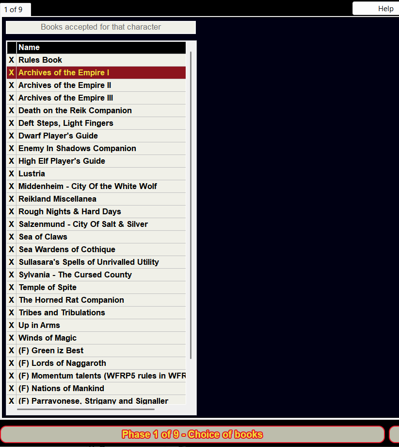

---

## Étape 0 — Les livres

Tu vois la liste des livres actifs (ceux choisis dans le menu principal). Tu ne peux qu'en **retirer** pour ce personnage : décoche ceux que tu ne veux pas utiliser.

Pourquoi c'est important : les livres cochés ici décident des races, des carrières, des talents et de l'équipement proposés pendant toute la création, et ils sont mémorisés avec le personnage.

- **Au moins un livre doit rester coché**, sinon tu ne peux pas passer à l'étape suivante.
- Si tu veux utiliser les talents Momentum plus tard, garde le livre Momentum coché.

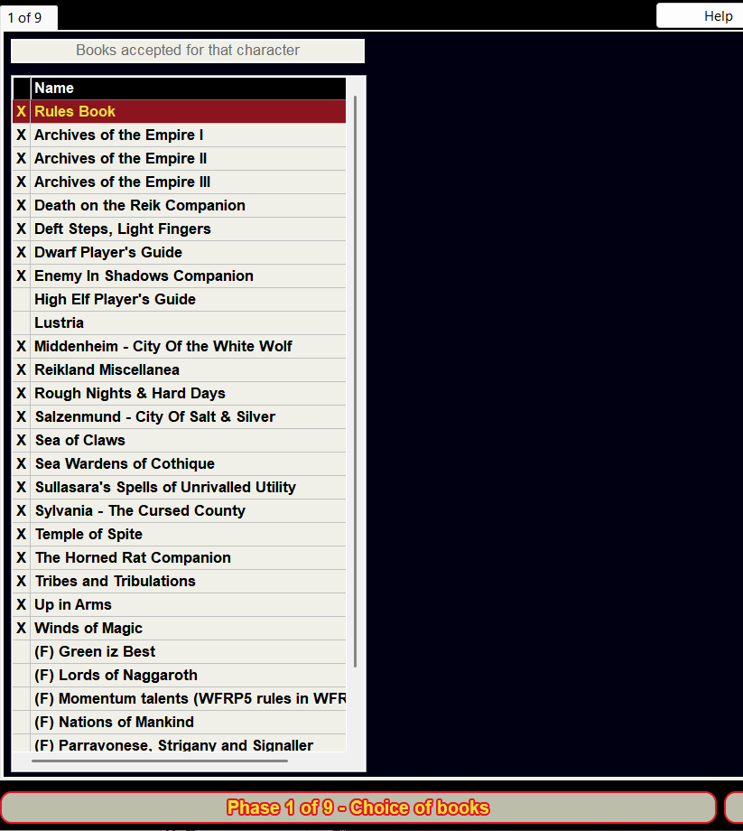

---

## Étape 1 — La race

Trois façons de choisir, chacune avec un coût ou un gain d'expérience de départ :

| Mode | Ce que tu fais | Xp |
|---|---|---|
| **Au hasard** | le programme tire la race | 20 Xp |
| **Donnez le résultat de votre lancé** | tu lances le dé toi-même et tu saisis le résultat | 20 Xp |
| **Au choix** | tu prends la race que tu veux | 0 Xp |

Passe à l'**étape suivante** quand tu es satisfait. Le chiffre est le nombre de Xp que le personnage **gagne** pour avoir laissé faire le hasard (règle du Rulebook) ; il s'ajoute aux Xp de départ.

Certaines races ouvrent des étapes en plus :
- **Skaven :** choix du **clan** (par la liste ou par tirage).
- **Mutant :** tirage de la **mutation de départ**.
- **Races avec background** (surtout WFRP2) : étape **Background**, avec un d10 à lancer.

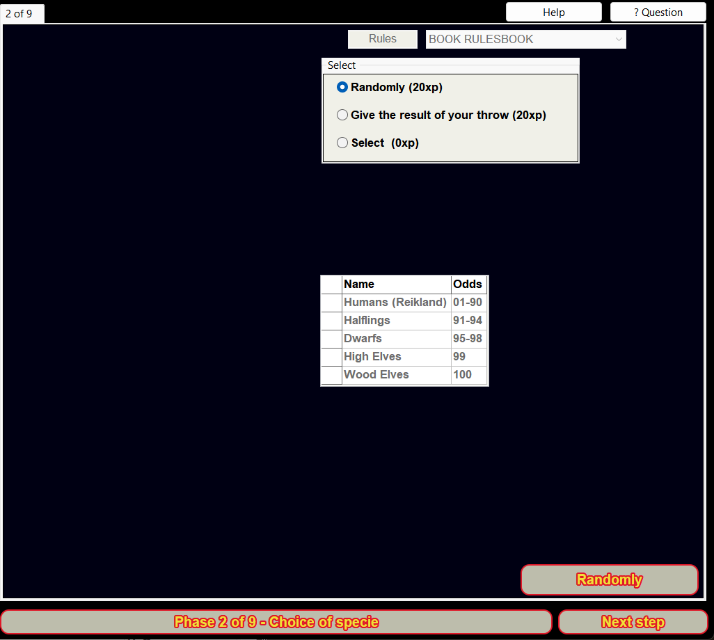

---

## Étape 2 — Le métier (carrière)

Même principe qu'à l'étape 1 :

| Mode | Xp |
|---|---|
| Au hasard | 50 Xp |
| Donnez le résultat de votre lancé | 50 Xp |
| Au choix | 0 Xp |

Points particuliers :
- **Sous-métier :** certains tirages demandent un second jet pour départager deux carrières proches (exemple : l'Apothicaire et l'Alchimiste mondain). Un bouton **Sélectionner** apparaît alors.
- **Métier de remplacement :** pour quelques races, le livre propose de remplacer la carrière tirée par une autre.
- **Appartenance :** pour certaines carrières (par exemple le Soldat), tu choisis un régiment ou une appartenance. C'est facultatif.
- **Règle de tirage :** si un livre propose une table de tirage différente pour ta race, une liste de règles apparaît.

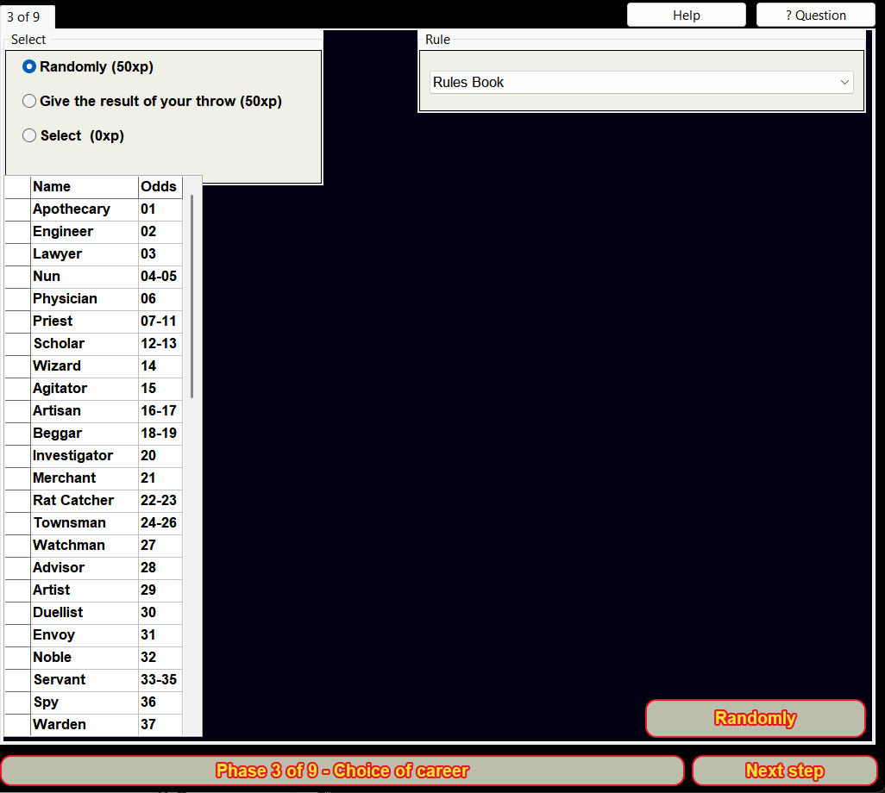

---

## Étape 3 — Les caractéristiques (attributs)

Cinq façons de procéder :

| Mode | Ce que tu fais | Xp |
|---|---|---|
| **Au hasard** | tirage automatique, valeurs fixées | 50 Xp |
| **Donnez le résultat de votre lancé** | tu saisis tes propres jets | 50 Xp |
| **Au hasard et affectez** | tirage automatique, mais tu décides quelle valeur va à quelle caractéristique | 25 Xp |
| **Donnez vos lancés de dé et affectez** | tes jets, que tu répartis | 25 Xp |
| **Répartissez 100 points** | tu distribues 100 points toi-même | 0 Xp |

À savoir :
- Chaque caractéristique = **2d10 + la base de la race**.
- En mode « répartissez 100 points », le total doit faire **exactement 100**, sinon le passage à l'étape suivante est refusé.
- Les points de **Destin** et de **Résilience** sont des points en plus à répartir entre les deux.
- Les **Blessures** sont calculées à partir des caractéristiques ; tu n'as rien à saisir.

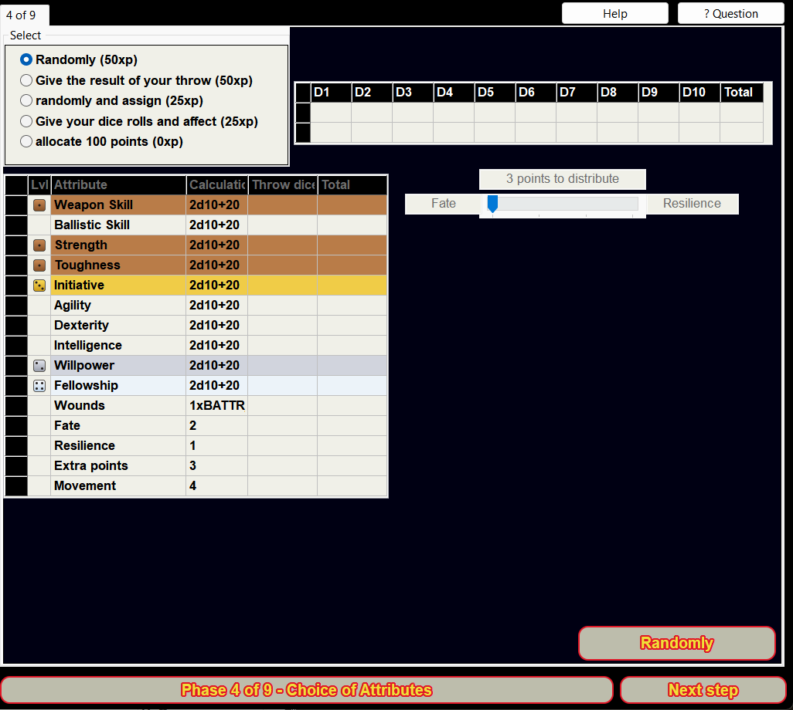

---

## Étape 4 — Les talents

Les talents de départ viennent de la race. Quand un talent propose un choix (« A ou B » ou « X (n'importe quel…) »), **tu dois trancher** : tant qu'un choix reste ouvert, tu ne peux pas continuer.

Un bouton **Au hasard** tire un talent quand la race le prévoit.

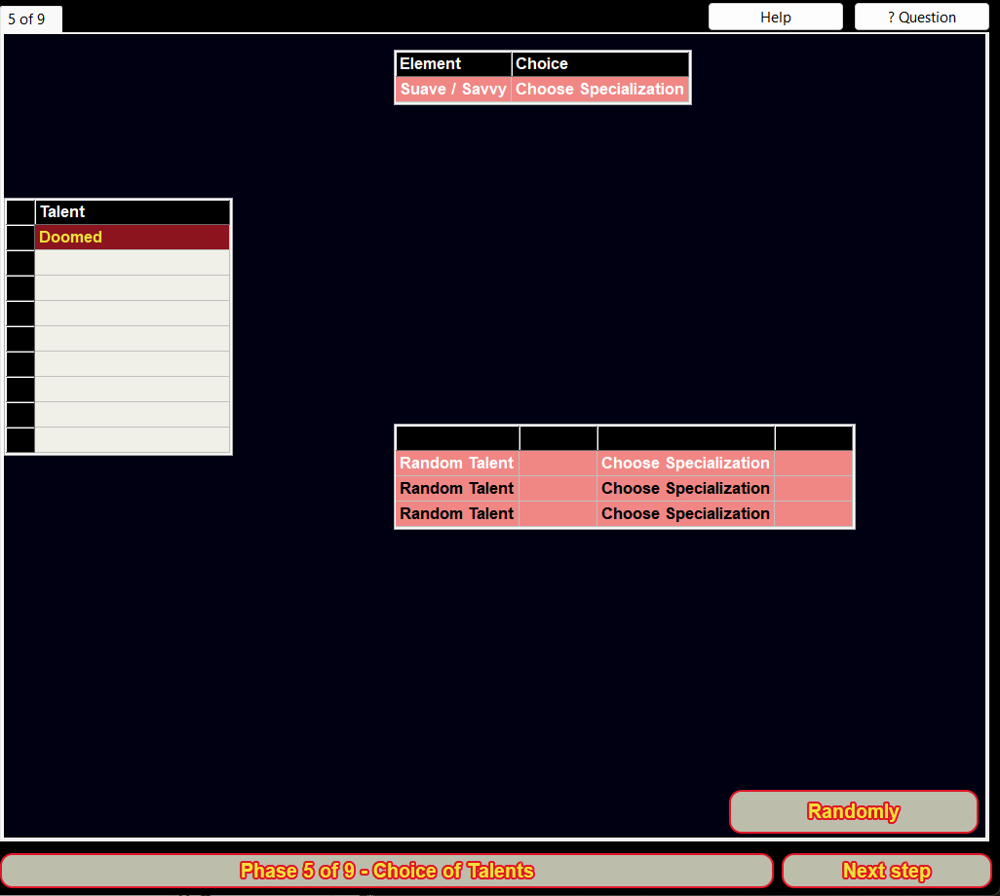

---

## Étape 5 — Les compétences de race

Ta race t'accorde des compétences à répartir. Dans le livre de règles, la plupart des races prennent **3 compétences à +5 et 3 compétences à +3** (le Skink de Lustria en prend 2 et 2).

- Le programme **refuse de continuer** tant que ces nombres ne sont pas exactement respectés.
- Une compétence « à spécialisation » (par exemple une langue) doit être précisée avant de passer.
- **Au hasard** répartit pour toi.

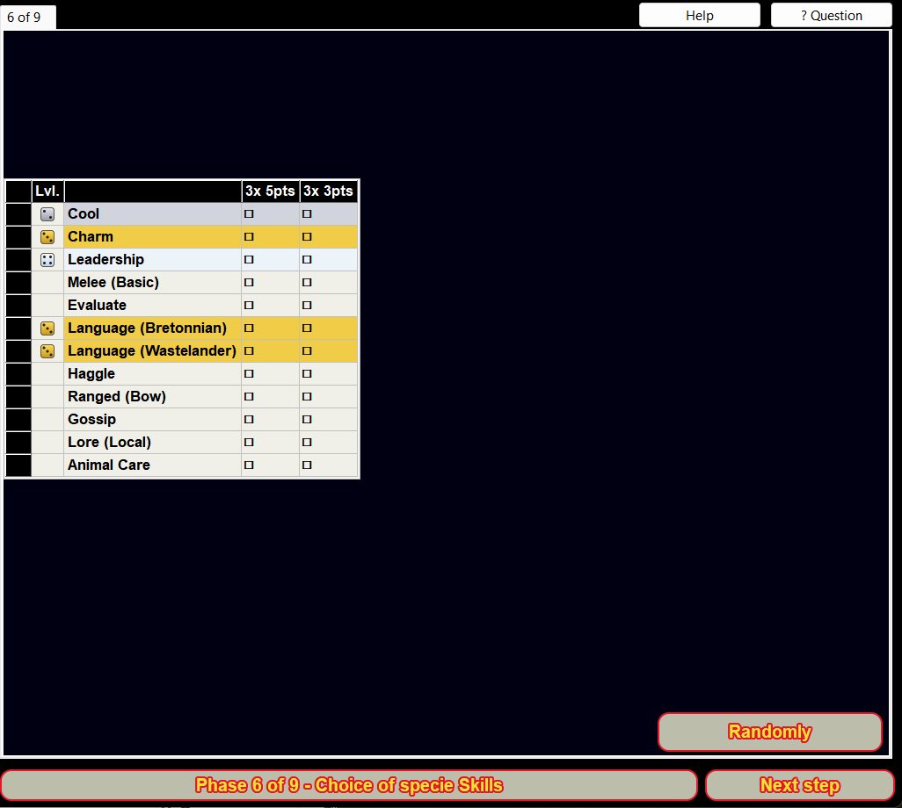

---

## Étape 6 — Les compétences de métier

Tu répartis **40 points** entre les compétences de ta carrière (en WFRP2, cette règle ne s'applique pas). Le compteur affiche « n / 40 Pts » ; il faut exactement 40.

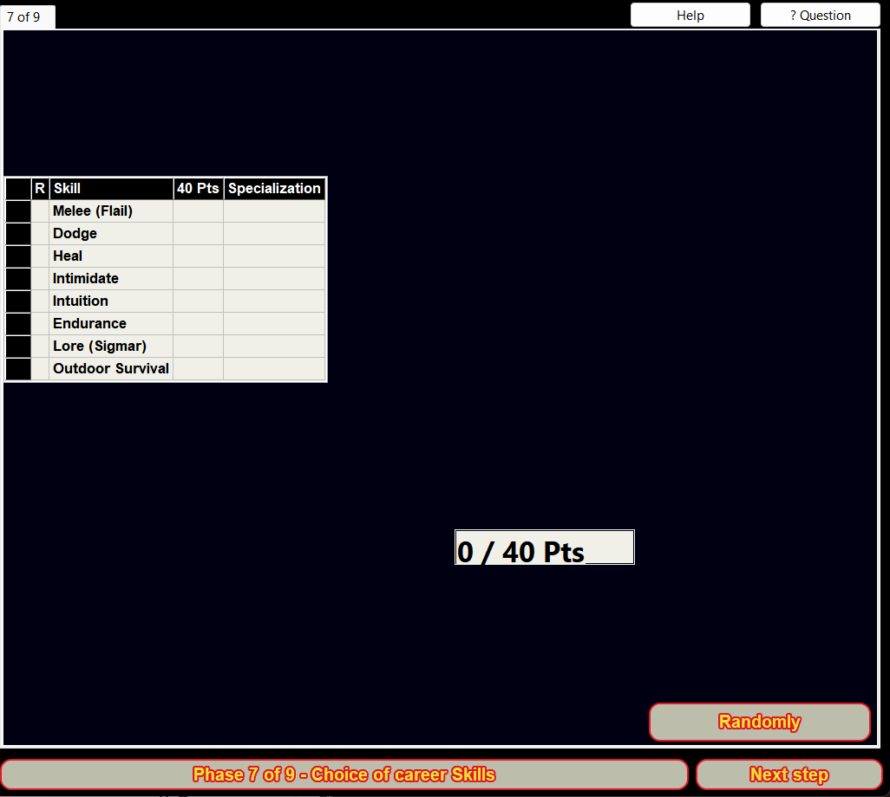

---

## Étape 7 — L'équipement

L'équipement de départ vient de ta carrière. Certaines lignes demandent un **choix** : tant qu'une ligne reste à choisir, l'étape ne se valide pas. Un bouton **Au hasard** choisit pour toi.

Tu peux aussi saisir ton **argent de départ** (en couronnes d'or).

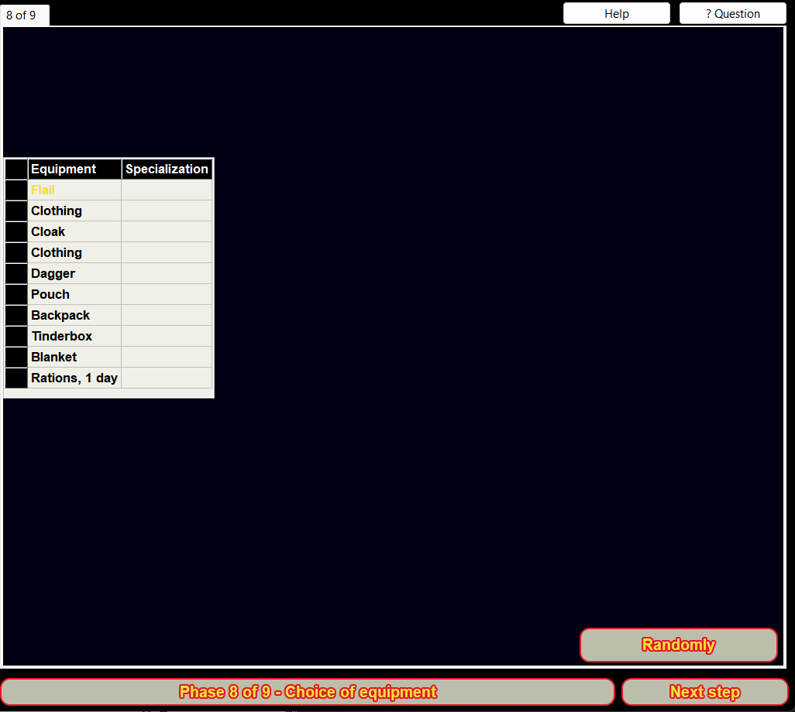

---

## Étape 8 — Le nom et la fin

- Donne un **nom** au personnage, ou clique sur **Lancer un nom** pour en tirer un.
- Le nom ne doit pas être vide, ne doit pas déjà exister, et les espaces au début et à la fin sont retirés.
- **Détails physiques** (âge, taille…) : un bouton ouvre la même fenêtre que sur la fiche, avec un tirage selon le Rulebook ou une saisie libre.

Quand tout est complet, le personnage est enregistré avec ses livres, et tu peux l'ouvrir pour le faire évoluer (voir **2. Modifier un personnage**).

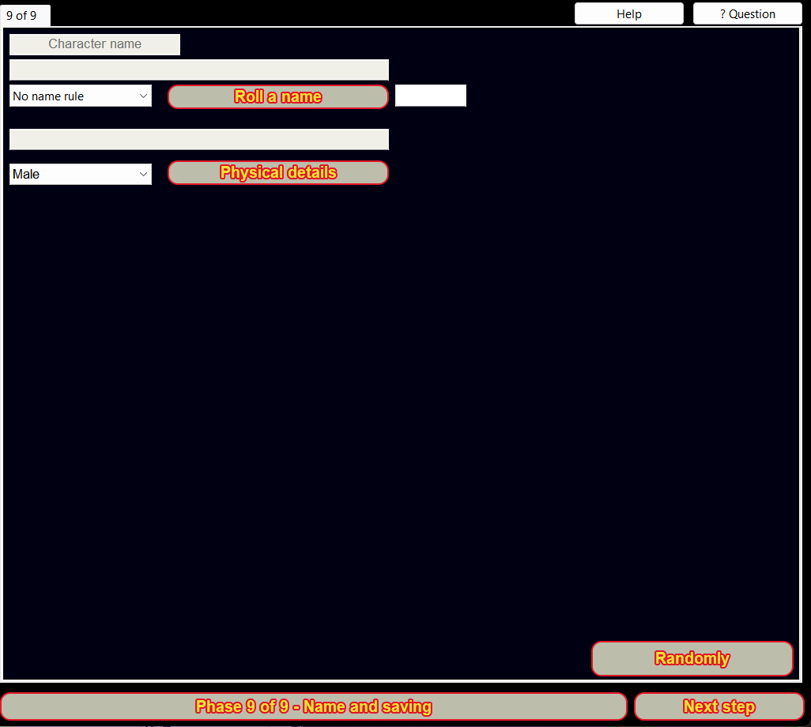

---

## Étapes en plus, selon la race et les livres

| Étape | Quand elle apparaît | Ce qu'on fait |
|---|---|---|
| **Clan** | race Skaven | choisir un clan par la liste ou par tirage |
| **Mutation de départ** | race Mutant | tirer la mutation (bouton « Tirer la mutation ») |
| **Background** | règles de background (surtout WFRP2) | lancer le d10, régler chaque choix |
| **Signe astral** | livre qui le prévoit (Archives of the Empire II) | tirer un signe ; il modifie des caractéristiques, donne un talent et rapporte **25 Xp** |
| **Appartenance** | certaines carrières (régiments, etc.) | choisir l'appartenance — facultatif |
| **Forme du familier** | carrière qui donne un familier | choisir ou tirer sa forme |

Exemple, l'étape **Signe astral** (bouton « Tirer un signe » ou choix dans la liste) :

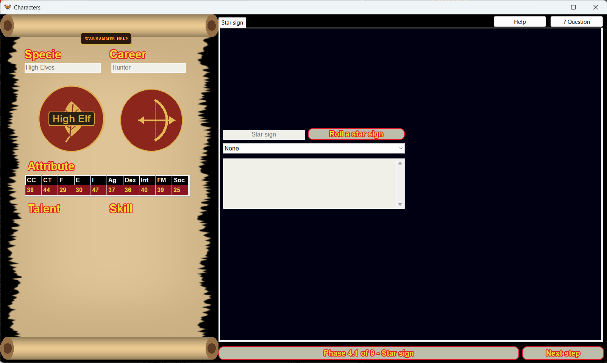

---

## Si tu es bloqué : les messages les plus fréquents

| Tu ne peux pas continuer parce que… | Ce qu'il faut faire |
|---|---|
| aucun livre n'est coché | recoche au moins un livre (étape 0) |
| aucune race / aucun métier | fais ton choix (ou clique sur **Randomly**), puis passe à l'**étape suivante** |
| une caractéristique n'a pas de jet | tire ou saisis tous les jets |
| le total des 100 points n'est pas 100 | corrige la répartition |
| un choix de talent reste ouvert | tranche chaque ligne « A / B » |
| le nombre de compétences de race est faux | respecte « 3 à +5 et 3 à +3 » (ou ce que dit le message) |
| le total des compétences de métier n'est pas 40 | ajuste jusqu'à 40 |
| un choix d'équipement reste ouvert | choisis ou clique sur **Au hasard** |
| le nom est vide ou déjà pris | change le nom |

---

## Différences selon la version

- **WFRP4 :** ce guide.
- **WFRP2 :** pas de répartition de 40 points en compétences de métier, ni de nombre imposé de compétences de race ; les tables de background (Liber Fanatica) et les tables de métier des livres annexes sont plus présentes.
- **WFRP1** (Rulebook p.14-18) : les étapes suivent l'ordre de la première édition et l'étape des Talents n'existe pas (les compétences remplacent les talents).  1. **Livres**, puis **Espèce**, comme d'habitude.
  2. Les **caractéristiques** viennent *avant* la classe, car la classe en dépend. Pour chaque ligne, tu choisis : tirer les dés, donner ton résultat de dés, ou choisir la valeur ; en mode tirage, un double-clic relance seulement la ligne sélectionnée. Une case applique la règle d'*intelligence supérieure* si les livres chargés la proposent.
  3. **Classe** (Académique, Guerrier, Rôdeur, Voyou) : seules les classes dont les exigences sont remplies sont proposées (une espèce peut remplacer une exigence, par exemple le Voyou elfe). Choisis, ou laisse le hasard en tirer une parmi les permises.
  4. **Âge et compétences de départ** : tire l'âge (ou saisis-le) ; le nombre de compétences est un d4 plus un modificateur d'âge. Les compétences que donne ton espèce comptent dans ce total ; le hasard (table d100) complète le reste, un doublon étant relancé. Choix libre : double-clic sur une compétence de la table. Double-clic sur une compétence choisie pour la retirer.
  5. **Carrière de base**, d'après la table de la classe et ton espèce (d100). Pour la classe Artisan il faut aussi un **métier** (seconde table d100). Une case remplace le tableau Académique par la version révisée quand le livre Realms of Sorcery est chargé.
  6. **Équipement** : les textes du livre pour la classe et la carrière, puis une liste de prix où un double-clic ajoute un objet (autant d'exemplaires que tu veux). L'argent se tire d'après la formule du livre (par exemple 3D6 Couronnes d'or) ou se saisit.
  7. **Nom**, avec le bouton **Détails physiques** (l'âge est celui fixé à l'étape 4 ; la taille dépend du sexe ; ni yeux ni cheveux).
