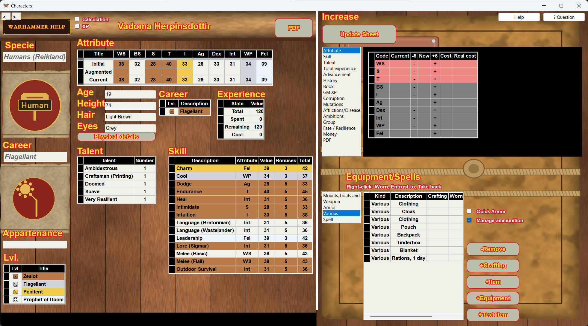
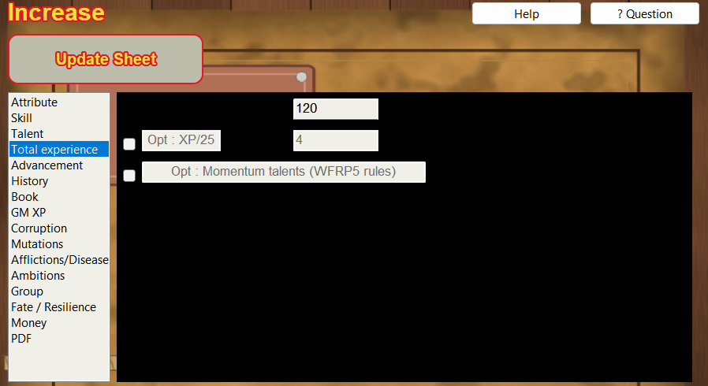
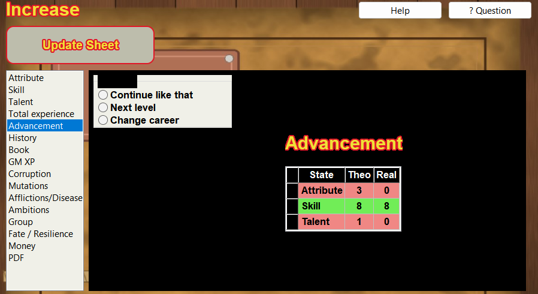
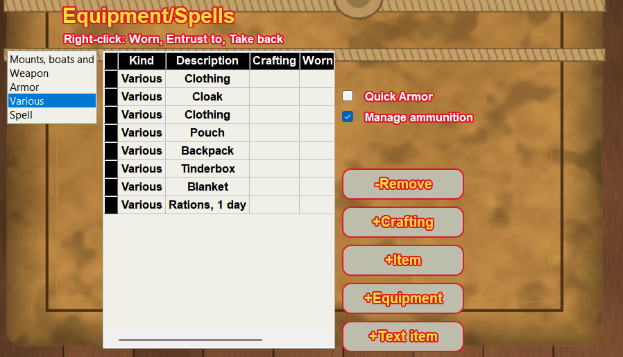
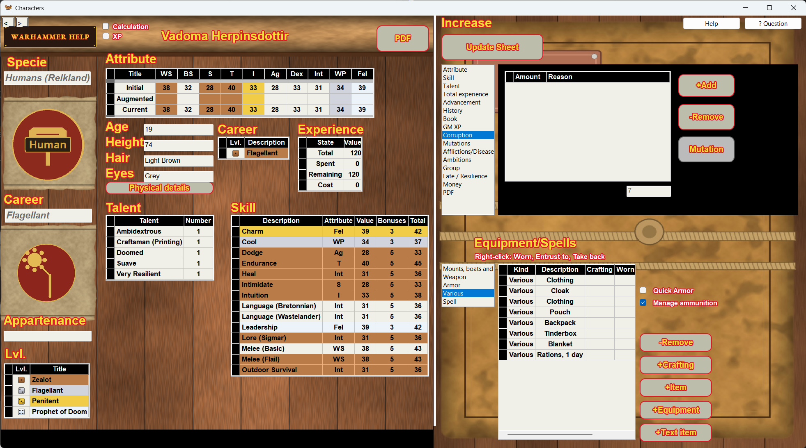
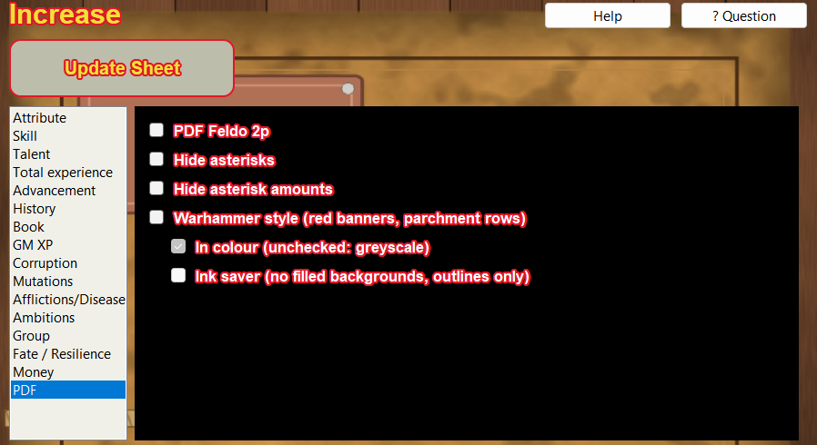

# Guide du joueur — 2. Faire évoluer un personnage

*Règles WFRP4. Version anglaise : `PLAYER_GUIDE_2_MODIFICATION.md`.*

Pour qui : un joueur dont le personnage est déjà créé et qui veut le faire évoluer, ou un habitué qui cherche un point précis (les fiches par question sont en phase 3).

Astuce : sur presque tous les boutons et cases à cocher, **F1** affiche une courte explication.

---

## Ouvrir un personnage

Ouvre le personnage depuis le menu principal. La fiche se partage en deux : les **tableaux de la fiche** (caractéristiques, compétences, talents, sorts, équipement) et, sur le côté, une liste de **pages** pour tout ce qui évolue : Attribut, Compétence, Talent, Total expérience (les Xp), Evolution (l'avancement), Historiques, Livre, MJ XP, Corruption, Mutations, Afflictions/Maladies, Ambitions, Groupe, Destin / Résilience, Monnaie et PDF. Selon la version de règles, certaines pages n'apparaissent pas.

Deux règles à retenir :

- **Rien n'est définitif avant d'avoir cliqué sur Sauve Fiche.** Les changements vivent à l'écran ; **Sauve Fiche** écrit le fichier et ferme la fenêtre. Si l'enregistrement échoue, la fenêtre reste ouverte.
- Les livres avec lesquels le personnage a été créé restent attachés à lui. Pour utiliser un élément d'un autre livre (par exemple les talents Momentum), ce livre doit faire partie des livres du personnage.

---

## L'expérience (Xp)

Sur la page **Total expérience** :

- **Xp total** : saisis le total d'Xp gagnés par le personnage, en unités brutes, comme sur la fiche. Les Xp dépensés et restants sont calculés pour toi.
- **Opt : XP/25** : coche-la si tu comptes les Xp dans la nouvelle unité (total divisé par 25, arrondi vers le bas). Dépensés et restants suivent la même unité.
- Les colonnes de **coût en Xp** et de **détail du calcul** peuvent être affichées ou cachées dans les tableaux ; cela ne change que l'affichage.

---

## Dépenser ses Xp : l'avancement

Sur la page **Evolution**, tu décides ce que le personnage fait de ses Xp :

1. Dans les tableaux de la fiche, saisis les **avancées** voulues (caractéristiques, compétences, talents). Le coût est calculé d'après la carrière et les avancées déjà achetées.
2. Choisis ce qui arrive à la carrière :
   - **Continuer tel quel** : même niveau, même carrière.
   - **Niveau suivant** : le personnage passe au niveau suivant de sa carrière (ou à la carrière suivante).
   - **Changer de métier** : choisis la nouvelle carrière dans la liste (bouton **Sélectionner**).
3. Clique sur **MAJ Fiche** : les avancées et le changement de carrière sont appliqués et les Xp dépensés sont déduits.

À savoir :

- Une carrière dont le premier niveau dépasse 1 (carrière avancée, par exemple le Tisseur de tempêtes) ne se commence pas directement : on y arrive en montant depuis sa carrière parente. Le programme la refuse avec un message.
- Le changement de carrière n'est proposé que parmi les carrières de l'espèce et des livres du personnage.
- **Historiques** garde une ligne par mise à jour : sélectionne une ligne et clique sur le bouton **Voir** pour afficher la fiche dans cet état (vue en lecture seule : les boutons d'équipement disparaissent). C'est seulement pour regarder : tu ne peux pas revenir à cet état.

---

## Spécialisations

Une compétence ou un talent à spécialisation (« Savoir (Any) », « Mêlée (Any) ») doit être précisé. Sélectionne la ligne, puis clique sur **+ Spécialisation** pour en ajouter une propre au personnage. La ligne suit ensuite les règles de coût habituelles.

---

## L'équipement

Les boutons sous le tableau d'équipement ajoutent ce que le personnage porte. Chaque bouton n'apparaît que dans les catégories où il sert : **+Arme** dans Armes, **+Armure** dans Armures, **+Sort** dans Sorts, **+Objet texte** dans Divers, **+Équipement** dans Divers et Montures, **+Familier** dans Montures.

| Bouton | Ajoute |
|---|---|
| **+Arme** | une arme |
| **+Armure** | une pièce d'armure (coche *armure simplifiée* pour des choix simplifiés) |
| **+Sort** | un sort à la liste |
| **+Équipement** | un objet des livres |
| **+Objet texte** | une ligne de texte libre |
| **+Objet** | un objet qui n'est dans aucun livre (catégories Armes, Armures et Divers) |
| **+Familier** | un familier ou une monture |
| **+Qualité** | une qualité de fabrication sur l'objet sélectionné (arme, armure ou autre) |
| **-Supprime** | retire l'objet sélectionné (avec confirmation) |

- Coche **Munitions** si tu veux que les munitions soient gérées et proposées dans l'équipement.
- Le bouton **-Supprime** n'apparaît pas dans la catégorie Sorts : un sort ne peut pas être retiré en WFRP4 (certaines autres règles le permettent). Supprimer un animal rend ses objets portés au personnage.
- En règles WFRP1, un sort s'apprend avec **Apprendre un sort** (catégorie Sorts).

---

## Corruption et mutations

Sur la page **Corruption** :

- **Ajoute** une ligne à chaque fois que le personnage gagne des points de corruption ; **Supprimer** retire la ligne sélectionnée (avec confirmation). Le compteur indique les points restants avant le prochain test.
- Après un test de Corruption raté, le bouton **Mutation** ouvre la liste des mutations. Un des choix permet de **dépenser de la Résilience** plutôt que de subir la mutation, quand de la Résilience est disponible.
- Les talents donnés ou retirés par une corruption sont suivis par le programme.

La page **Mutations** liste celles déjà subies (en WFRP1 la page porte un autre nom).

---

## Afflictions et maladies

Sur la page **Afflictions / Maladies** :

- **Ajouter une Affliction** ouvre le catalogue. Certaines Afflictions fixent leur malus par un jet de dé (par exemple « −1d10 Endurance ») : le programme montre le jet et **tu le valides ou le corriges** ; il ne tire jamais en silence. Annuler la fenêtre annule l'ajout.
- **Ajouter une Maladie** ouvre le catalogue des maladies.

---

## Ambitions et groupe

- **Ambitions** : ambitions à court et long terme, en texte libre. Double-clique dans le tableau pour modifier.
- **Groupe** : les biens partagés du groupe. Un groupe est **un seul fichier partagé** (`GROUPE_<nom>.xml`, à la racine du dossier des personnages). Chaque personnage ne retient que le nom du groupe : tous les membres voient donc les mêmes biens partagés et les mêmes ambitions de groupe (saisies dans la fenêtre du groupe, en lecture seule sur la page Ambitions du personnage). Double-clique sur la page Groupe pour ouvrir la fenêtre du groupe. Un membre ne peut pas quitter le groupe tant qu'un de ses objets est confié à un bien du groupe.

---

## Le MJ et les règles

- Page **MJ XP** : les Xp que distribue le meneur de jeu ; tu peux y suivre les montants.
- **Tout est modifiable hors livre officiel** : quand un personnage ou une fiche ne vient pas d'un livre officiel, rien n'est verrouillé. La phase 3 explique comment s'en servir pour des règles maison.

---

## La fiche PDF

Le bouton **PDF** crée la fiche du personnage avec les valeurs affichées à l'écran. Options (cases sous le bouton) :

| Option | Effet |
|---|---|
| **PDF 2 pages (Feldo)** | la fiche de deux pages au lieu de la fiche habituelle |
| **Sans astérisque** | cache les marques qui renvoient aux notes |
| **Sans montant** | garde les astérisques mais cache leurs montants |
| **Style Warhammer** | bandeaux rouges et lignes de parchemin (PDF Feldo) |
| **Couleur** | PDF en couleur ; décochée = niveaux de gris |
| **Économie d'encre** | contours seulement, pas d'aplats |

**Détails physiques** (âge, taille…) : un bouton ouvre la fenêtre avec un jet du livre de règles ou une saisie libre ; le résultat est recopié sur la fiche.

---

## L'option Momentum (WFRP4 ↔ WFRP5)

Une case sur la page Total expérience remplace les talents du livre de règles (WFRP4) par leurs versions Momentum (WFRP5). Le livre Momentum doit faire partie des livres du personnage, sinon un message te le dit. Détails dans la fiche de la phase 3.

---

## Si tu es bloqué

| Tu n'arrives pas à… | Que faire |
|---|---|
| changer de carrière | la carrière est avancée (niveau supérieur à 1) : monte depuis sa carrière parente |
| utiliser un talent Momentum | ajoute le livre Momentum aux livres du personnage |
| lire tes Xp dans la bonne unité | coche ou décoche **Opt : XP/25** |
| revenir à un état antérieur | page Historiques, sélectionne la ligne, **Voir** |
| quitter sans perdre ton travail | clique sur **Sauve Fiche** : fermer autrement perd les changements non enregistrés (le code ne demande aucune confirmation à la fermeture) |

---

## Différences selon la version

- **WFRP4 :** ce guide.
- **WFRP2 / WFRP1 :** même logique (Xp, avancées, changement de carrière). Ce qui change :
  - **Carrières (les deux) :** pas de tableau de niveaux de carrière et, en WFRP2, pas de ligne « appartenance ». Quitter une carrière compte les exigences en caractéristiques et compétences (et talents en WFRP2) face aux Xp nécessaires ; un message dit ce qui manque ou les Xp qui font défaut.
  - **WFRP2 :** les avancées de compétence se font par pas de **10** (au lieu de 5 en WFRP1) ; la page Mutations propose les **Marques des Dieux** (une entrée par domaine divin) et la **mutation du Chaos** (tirage d1000, du Tome of Corruption).
  - **WFRP1 :**
    - Il n'y a **pas de page Talents** ni de tableau de talents : les compétences les remplacent (la liste des pages est plus courte), et les panneaux Résilience et Détermination ne sont pas affichés.
    - Un sort s'apprend avec **Apprendre un sort**. Passer au niveau suivant d'une carrière de lanceur de sorts est refusé tant qu'il manque les sorts exigés.
    - **Prêtres** (Realm of Divine Magic) : passer au rang suivant exige toutes les prières requises du rang actuel, coûte 100 Xp × le rang visé pour le jet de la Cleric Advance Table, et la divinité juge l'avancement (d100). Des cadeaux peuvent suivre (Xp, un point de Destin, une bénédiction). Un **Initié** choisit un culte et reçoit les quatre prières Petty de départ ; un **Prêtre druidique** de niveau 1 reçoit un familier (d100).
    - Entrer dans un niveau de carrière magique donne des **points de magie** (jet de dés du livre).
    - La page Mutations liste les *handicaps* un par ligne, avec une case « Magicien mauvais ».
