# Player's guide — 1. Creating a character

*WFRP4 rules. French version: `GUIDE_JOUEUR_1_CREATION_FR.md`.*

Who it is for: a player discovering the program, and a regular who wants to find one specific point (the per-question sheets are in phase 3).

---

## Before you start: the rules version

The rules version (WFRP1, WFRP2, WFRP4) is chosen **before** creating the character and does not change afterwards. A WFRP1 character cannot become a WFRP4 character: characteristics, careers and skills do not match. If you change your mind, create a new character.

The only exception is between WFRP4 and the Momentum variant (WFRP5): see the "Momentum option" sheet (phase 3).

---

## The route at a glance

Creation is a series of **steps**, always in the same order. The **Next step** button only moves on when the current step is complete; otherwise a message tells you what is missing.

| Step | Tab | What you do |
|---|---|---|
| 0 | Books | choose the books to use |
| 1 | Specie | choose the species |
| 2 | Career | choose the career |
| 3 | Attribute | set the characteristics |
| 4 | Talent | choose the talents |
| 5 | Specie's Skills | spread the species skill points |
| 6 | Work's skills | spread the career skill points |
| 7 | Equipment | choose the starting equipment |
| 8 | Name | name the character, then save |

Depending on the species and the books, **extra steps can slot in** (clan, starting mutation, background, star sign, affiliation, familiar form). They are described below.

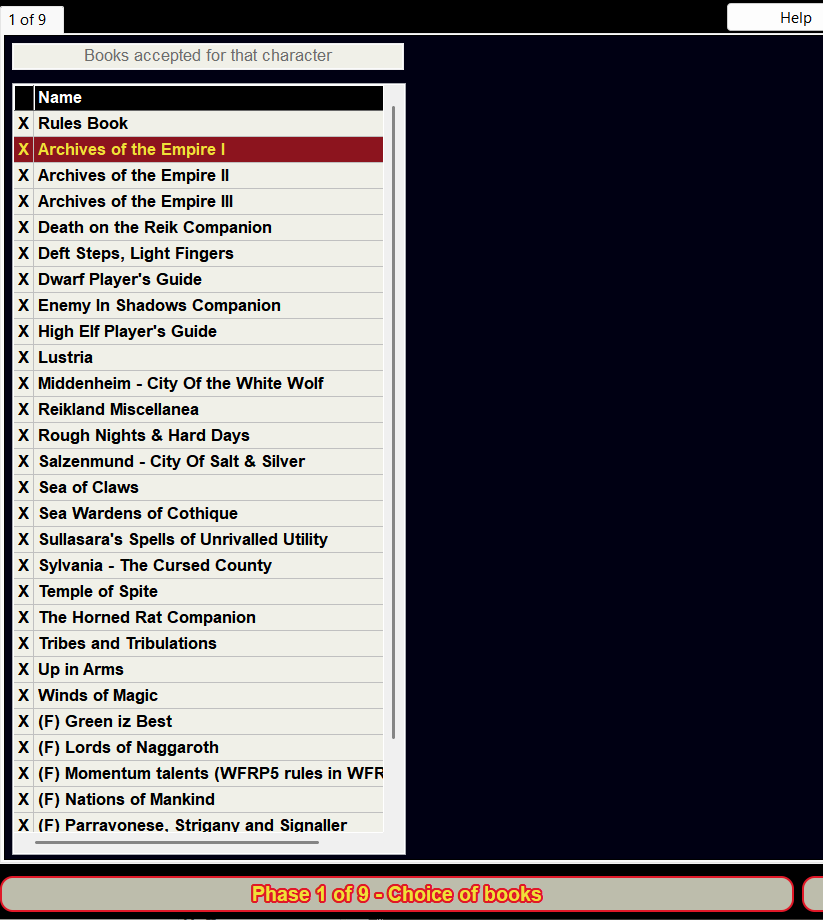

---

## Step 0 — Books

You see the list of active books (the ones chosen in the main menu). You can only **remove** books for this character: untick the ones you do not want.

Why it matters: the books ticked here decide which species, careers, talents and equipment are offered during the whole creation, and they are stored with the character.

- **At least one book must stay ticked**, otherwise you cannot go to the next step.
- If you plan to use Momentum talents later, keep the Momentum book ticked.

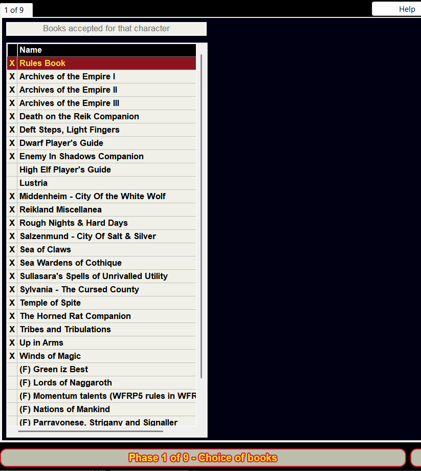

---

## Step 1 — Species

Three ways to choose, each with a starting experience bonus or cost:

| Mode | What you do | Xp |
|---|---|---|
| **Randomly** | the program rolls the species | 20 Xp |
| **Give the result of your throw** | you roll the die yourself and enter the result | 20 Xp |
| **Select** | you take the species you want | 0 Xp |

Go to the **Next step** when you are happy. The figure is the Xp the character **gains** for leaving it to chance (Rulebook rule); it is added to the starting Xp.

Some species open extra steps:
- **Skaven:** choice of **clan** (from the list or by roll).
- **Mutant:** roll the **starting mutation**.
- **Species with a background** (mostly WFRP2): a **Background** step, with a d10 to roll.

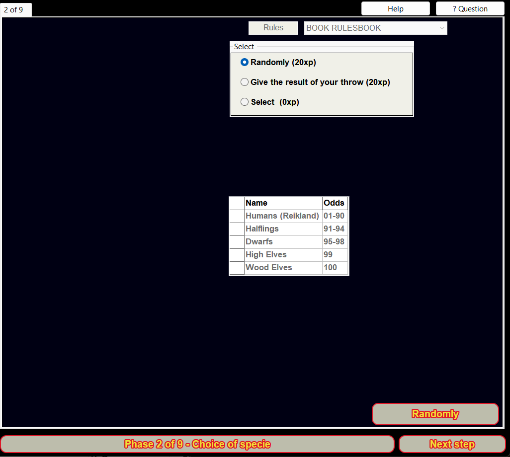

---

## Step 2 — Career

Same principle as step 1:

| Mode | Xp |
|---|---|
| Randomly | 50 Xp |
| Give the result of your throw | 50 Xp |
| Select | 0 Xp |

Special points:
- **Sub-career:** some rolls call for a second roll to separate two close careers (for example the Apothecary and the Mundane Alchemist). A **Select** button then appears.
- **Replacement career:** for a few species, the book offers to replace the rolled career with another one.
- **Affiliation:** for some careers (for example the Soldier) you choose a regiment or an affiliation. It is optional.
- **Roll rule:** if a book offers a different roll table for your species, a list of rules appears.

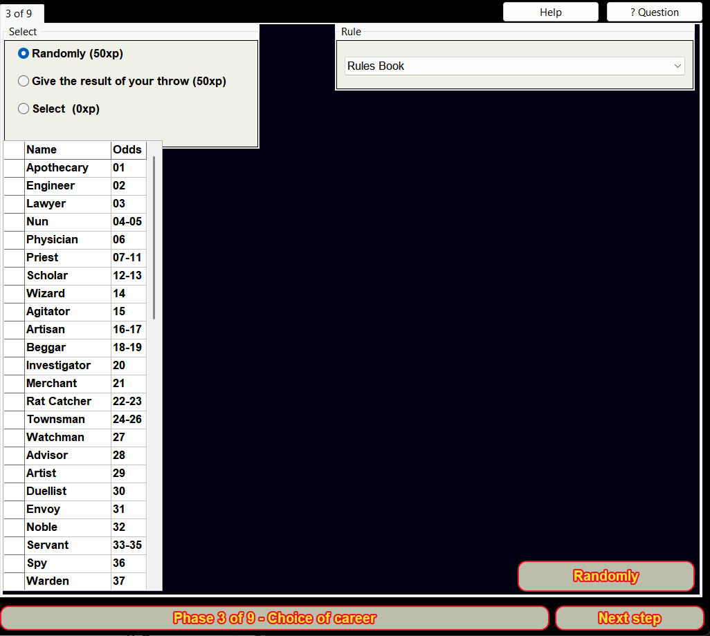

---

## Step 3 — Characteristics (attributes)

Five ways to proceed:

| Mode | What you do | Xp |
|---|---|---|
| **Randomly** | automatic roll, values fixed | 50 Xp |
| **Give the result of your throw** | you enter your own rolls | 50 Xp |
| **Randomly and assign** | automatic roll, but you decide which value goes to which characteristic | 25 Xp |
| **Give your dice rolls and affect** | your rolls, which you assign | 25 Xp |
| **Allocate 100 points** | you distribute 100 points yourself | 0 Xp |

Good to know:
- Each characteristic = **2d10 + the species base**.
- In "allocate 100 points" mode the total must be **exactly 100**, otherwise the next step is refused.
- **Fate** and **Resilience** points are extra points to split between the two.
- **Wounds** are computed from the characteristics; you enter nothing.

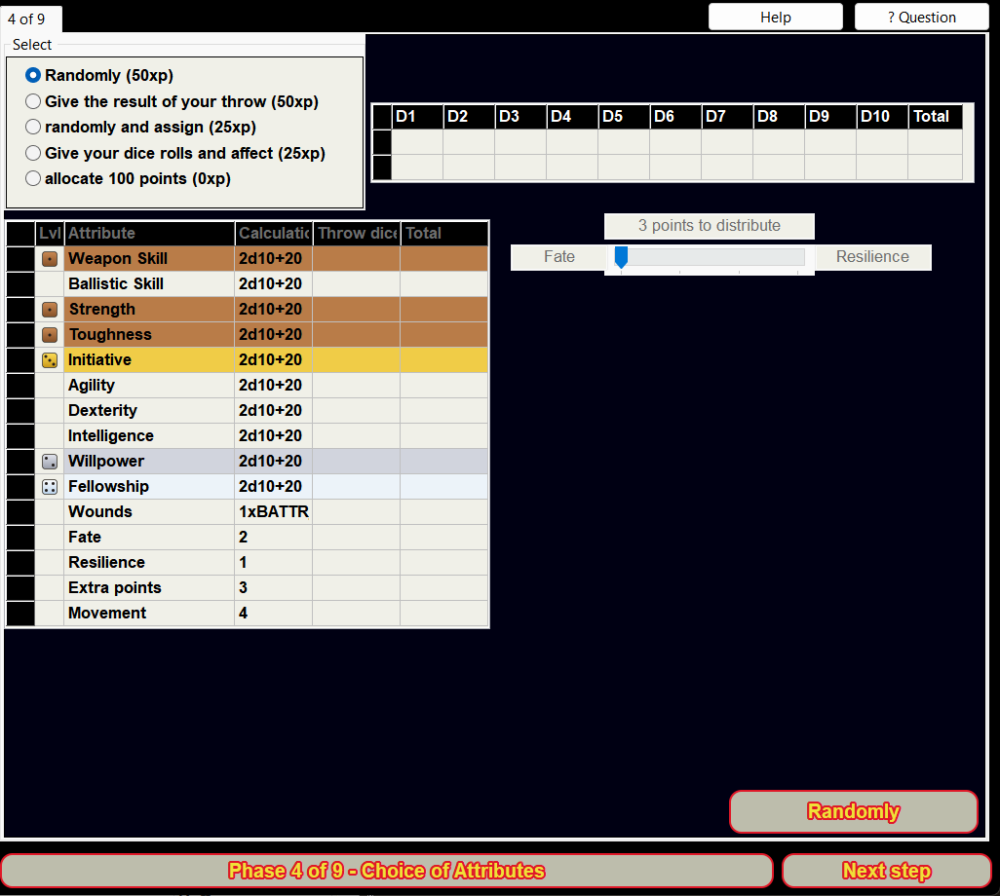

---

## Step 4 — Talents

The starting talents come from the species. When a talent offers a choice ("A or B", or "X (Any)"), **you must decide**: while a choice stays open you cannot continue.

A **Randomly** button rolls a talent when the species provides for it.

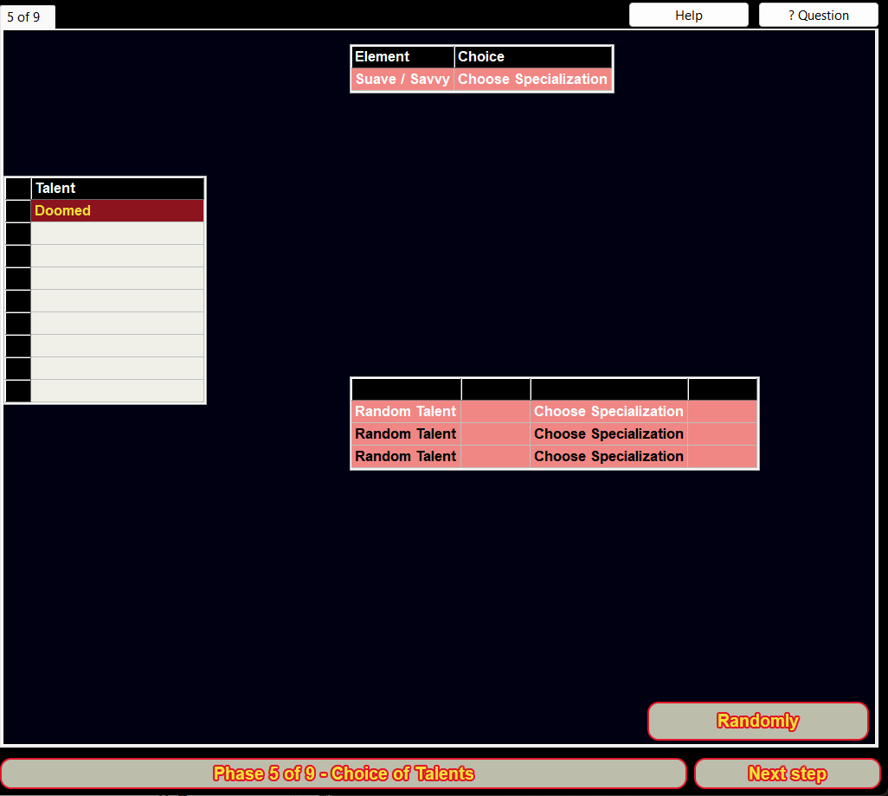

---

## Step 5 — Species skills

Your species gives you skills to spread. In the Rulebook most species take **3 skills at +5 and 3 skills at +3** (the Lustrian Skink takes 2 and 2).

- The program **refuses to continue** until these numbers are exactly respected.
- A skill with a specialisation (a language, for example) must be specified before moving on.
- **Randomly** spreads them for you.

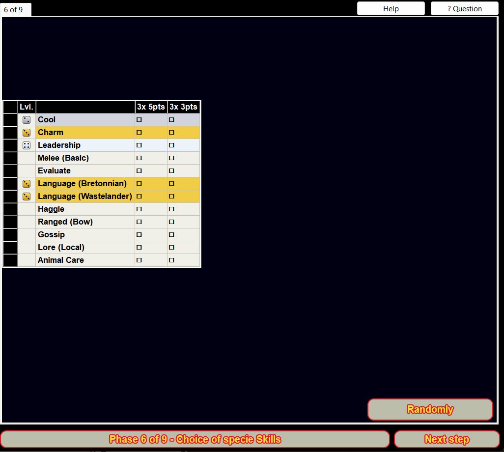

---

## Step 6 — Career skills

You spread **40 points** among your career skills (in WFRP2 this rule does not apply). The counter shows "n / 40 Pts"; it must be exactly 40.

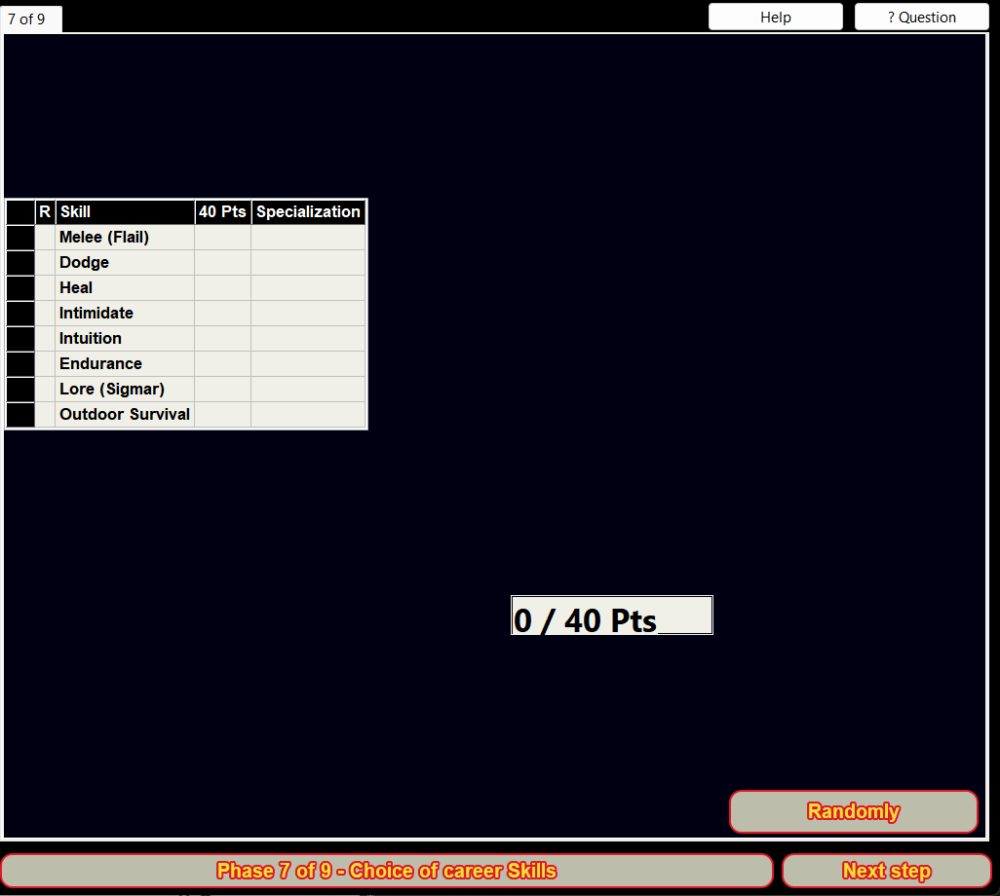

---

## Step 7 — Equipment

The starting equipment comes from your career. Some lines ask for a **choice**: while a line is still to choose, the step cannot be validated. A **Randomly** button chooses for you.

You can also enter your **starting money** (gold crowns).

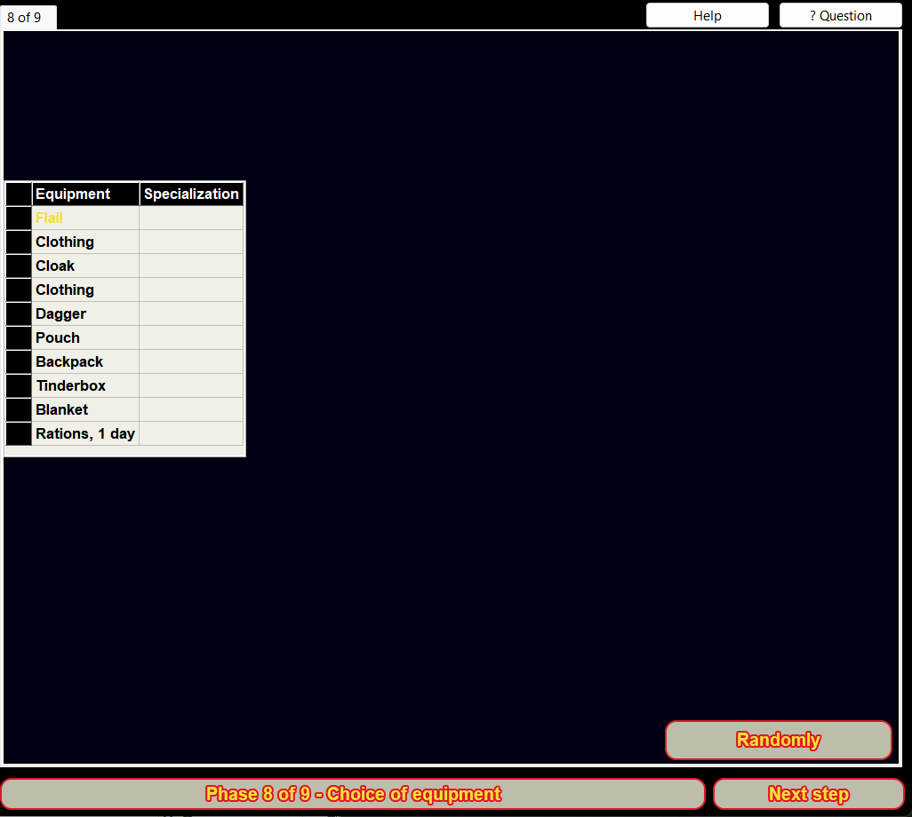

---

## Step 8 — Name and finish

- Give the character a **name**, or click **Roll a name** to draw one.
- The name must not be empty, must not already exist, and leading and trailing spaces are removed.
- **Physical details** (age, height…): a button opens the same window as on the sheet, with a roll from the Rulebook or free entry.

When everything is complete the character is saved with its books, and you can open it to let it evolve (see **2. Changing a character**).

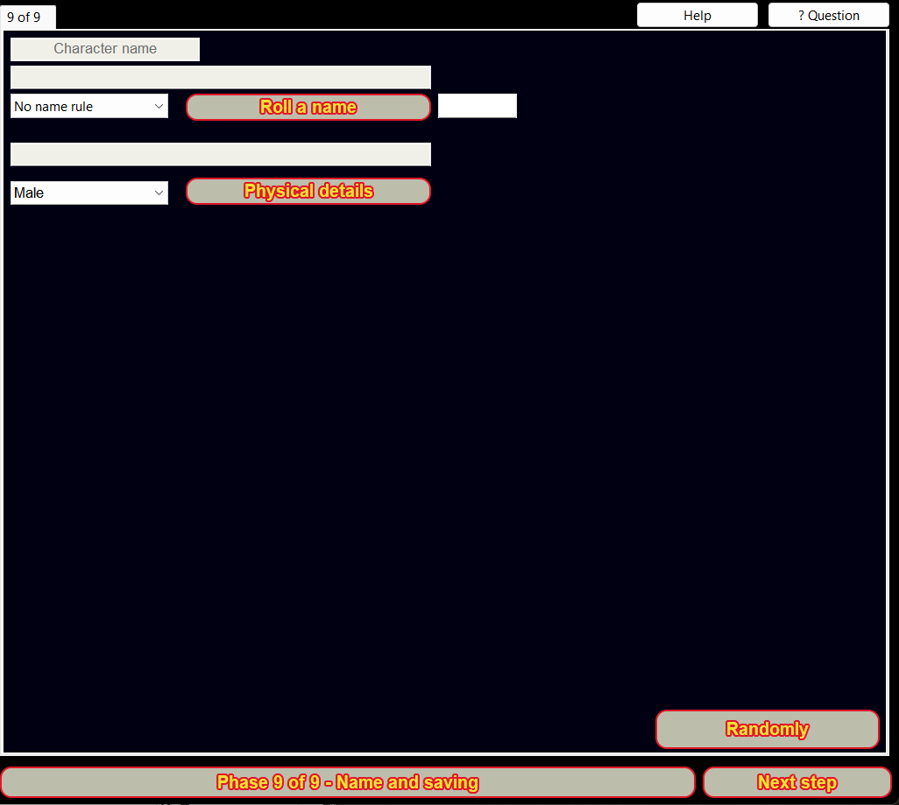

---

## Extra steps, depending on species and books

| Step | When it appears | What you do |
|---|---|---|
| **Clan** | Skaven species | choose a clan from the list or by roll |
| **Starting mutation** | Mutant species | roll the mutation ("Roll the mutation" button) |
| **Background** | background rules (mostly WFRP2) | roll the d10, settle each choice |
| **Star sign** | a book that provides it (Archives of the Empire II) | roll a sign; it changes characteristics, gives a talent and earns **25 Xp** |
| **Affiliation** | some careers (regiments, etc.) | choose the affiliation — optional |
| **Familiar form** | a career that gives a familiar | choose or roll its form |

Example, the **Star sign** step ("Roll a star sign" button or pick from the list):

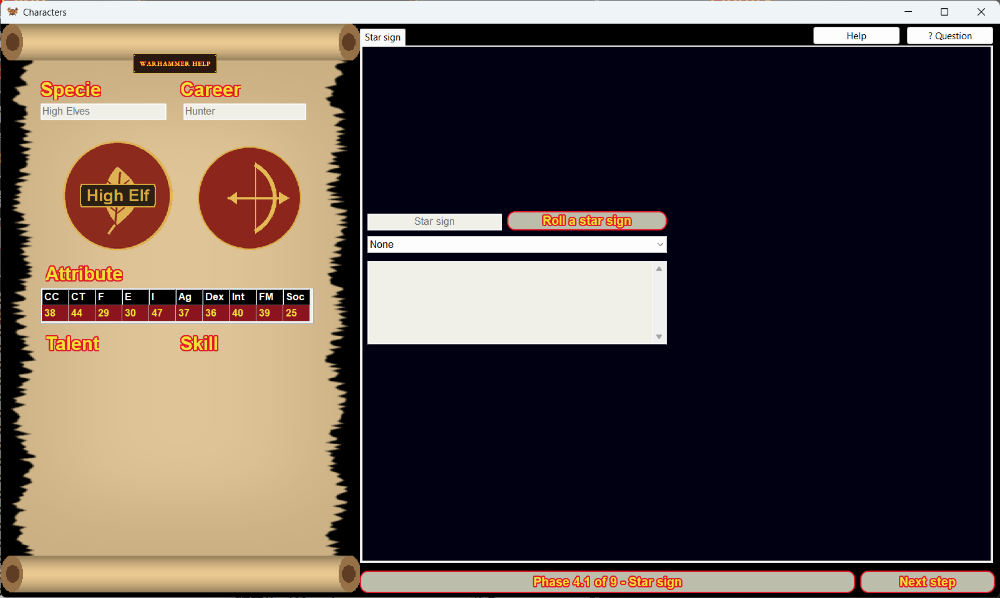

---

## If you are stuck: the most common messages

| You cannot continue because… | What to do |
|---|---|
| no book is ticked | tick at least one book (step 0) |
| no species / no career | make your choice (or click **Randomly**), then go to the **Next step** |
| a characteristic has no roll | roll or enter every roll |
| the 100-point total is not 100 | fix the allocation |
| a talent choice is still open | settle each "A / B" line |
| the number of species skills is wrong | follow "3 at +5 and 3 at +3" (or what the message says) |
| the career skills total is not 40 | adjust until 40 |
| an equipment choice is still open | choose, or click **Randomly** |
| the name is empty or already taken | change the name |

---

## Differences by version

- **WFRP4:** this guide.
- **WFRP2:** no 40-point split of career skills, and no fixed number of species skills; background tables (Liber Fanatica) and the career tables of the side books are more present.
- **WFRP1** (Rulebook p.14-18): the steps follow the first edition's order and the Talents step does not exist (skills replace talents). Written from the code, **[to check on screen]**:
  1. **Books**, then **Species**, as usual.
  2. **Characteristics** come *before* the class, because the class depends on them. For each line choose to roll the dice, give your dice result, or choose the value; in "roll" mode a double-click re-rolls only the selected line. A tick box applies the *greater intelligence* rule when the loaded books offer it.
  3. **Class** (Academic, Warrior, Ranger, Rogue): only the classes whose requirements are met are offered (a species may replace a requirement, e.g. elf Rogue). Choose, or let chance pick one among those allowed.
  4. **Age and starting skills**: roll the age (or enter it); the number of skills is a d4 plus an age modifier. The skills your species gives count in that total; chance (d100 table) completes the rest, a duplicate being re-rolled. Free choice: double-click a skill in the table. Double-click a chosen skill to remove it.
  5. **Base career**, from the class table and your species (d100). For the Artisan class a **trade** is also needed (second d100 table). A tick box swaps in the revised Academic table when the Realms of Sorcery book is loaded.
  6. **Equipment**: the class and career texts from the book, then a price list where a double-click adds an item (as many copies as you like). Money is rolled from the book's formula (for example 3D6 Gold Crowns) or entered.
  7. **Name**, with the **Physical details** button (age is the one fixed at step 4; height depends on sex; no eye or hair colour).
