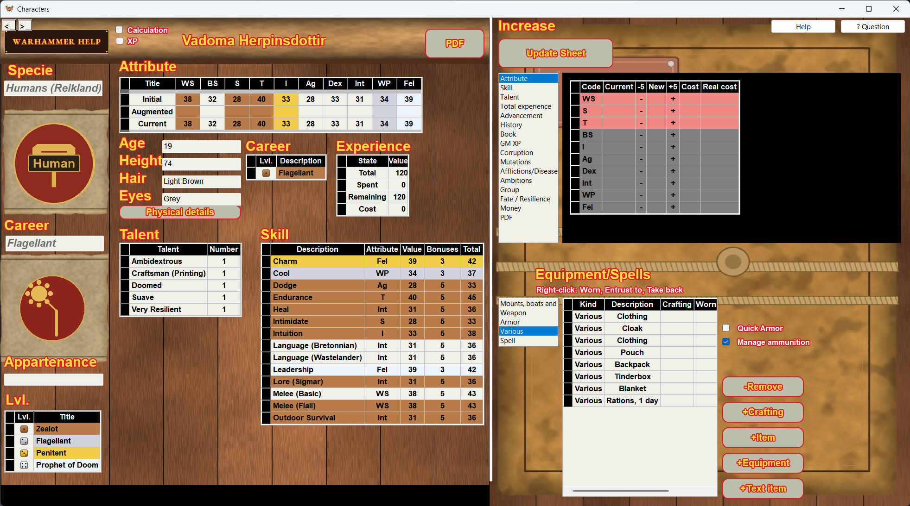
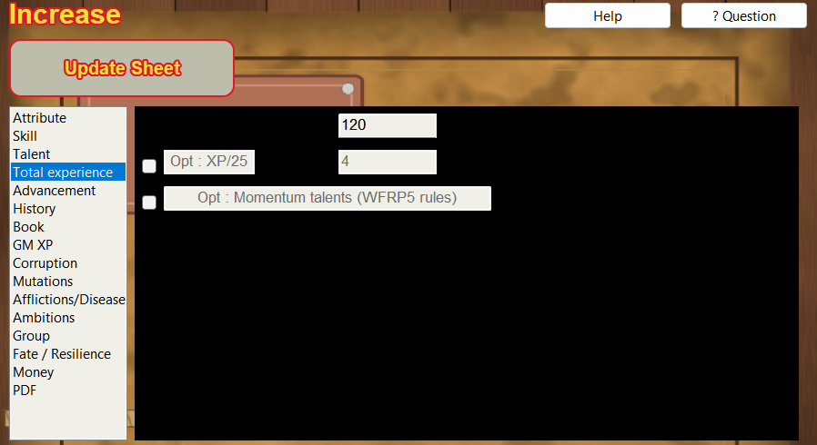
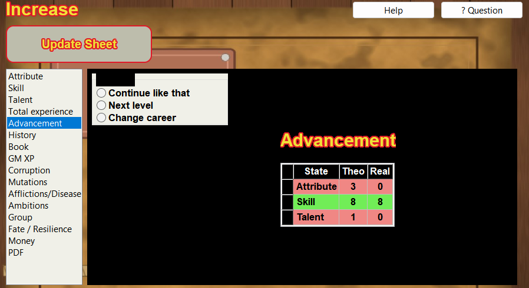
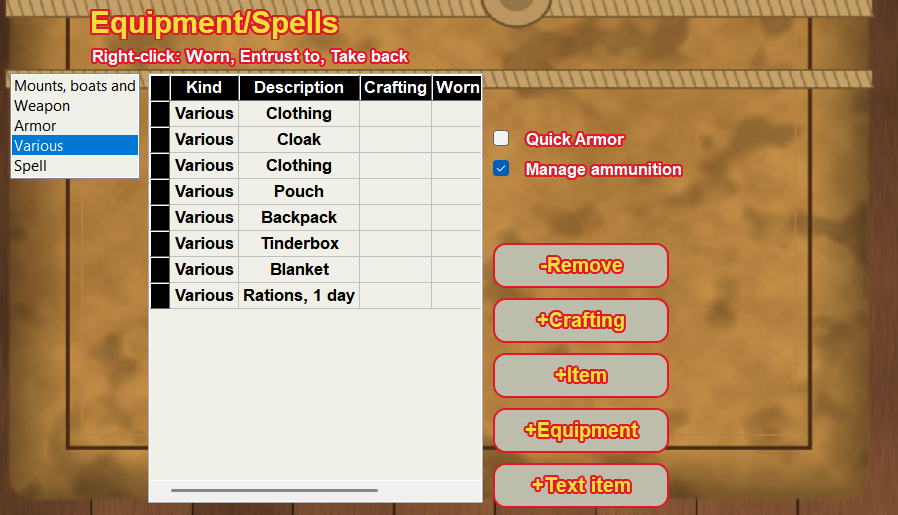
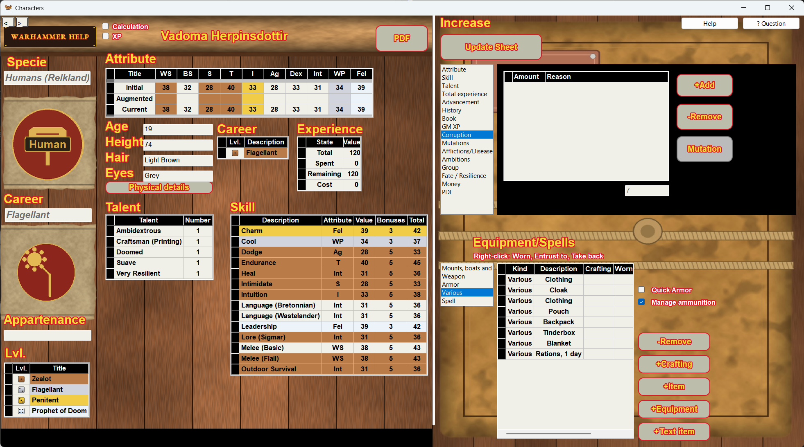
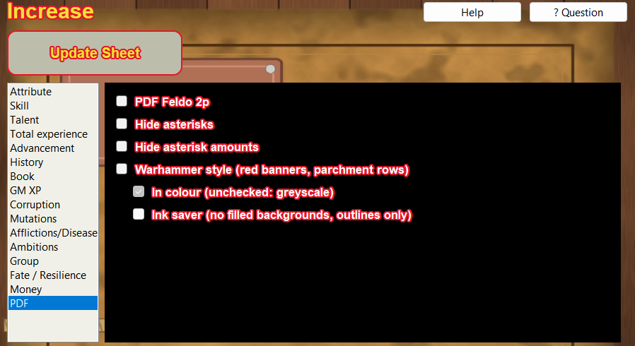

# Player's guide — 2. Changing a character

*WFRP4 rules. French version: `GUIDE_JOUEUR_2_MODIFICATION_FR.md`.*

Who it is for: a player whose character is already created and who wants to make it evolve, or a regular looking for one specific point (per-question sheets are in phase 3).

Tip: on almost every button and tick box, **F1** shows a short explanation of what it does.

---

## Opening a character

Open the character from the main menu. The sheet is split in two: the **sheet tables** (characteristics, skills, talents, spells, equipment) and, on the side, a list of **pages** for everything that evolves: Attribute, Skill, Talent, Total experience (the Xp), Advancement, History, Book, GM XP, Corruption, Mutations, Afflictions/Diseases, Ambitions, Group, Fate / Resilience, Money and PDF. Depending on the rules version, some pages do not appear.

Two rules to keep in mind:

- **Nothing is final until you click Save file.** Changes live on screen; **Save file** writes the file and closes the window. If saving fails, the window stays open.
- The books the character was created with stay attached to it. To use something from another book (for example the Momentum talents) that book must be among the character's books.

---

## Experience (Xp)

On the **Total experience** page:

- **Total Xp**: enter the total Xp earned by the character, in raw units, as written on the sheet. The spent and remaining Xp are computed for you.
- **Opt : XP/25**: tick it if you count Xp in the new unit (total divided by 25, rounded down). Spent and remaining follow the same unit.
- **Show Xp** (cost columns) and **calculation detail** can be shown or hidden in the sheet tables; this changes the display only.

---

## Spending Xp: advancing

On the **Advancement** page you decide what the character does with their Xp:

1. In the sheet tables, enter the **advances** you want (characteristics, skills, talents). The cost is computed from the career and the advances already bought.
2. Choose what happens to the career:
   - **Continue like that**: same level, same career.
   - **Next level**: the character moves to the next level of their career (or to the next career).
   - **Change career**: pick the new career from the list (**Select** button).
3. Click **Update sheet**: the advances and the career change are applied and the Xp spent are deducted.

Good to know:

- A career whose first level is above 1 (an advanced career, for example the Storm Weaver) cannot be started directly: you reach it by climbing from its parent career. The program refuses it with a message.
- Changing career is only offered among the careers of the character's species and books.
- **History** keeps a line for each update: select a line and click the **See** button to show the sheet in that state (read-only view: equipment buttons are hidden). It is only for looking: you cannot go back to that state.

---

## Specialisations

A skill or a talent with a specialisation ("Lore (Any)", "Melee (Any)") must be specified. Select the line, then click **+ Specialisation** to add one of the character's own. The line then follows the usual cost rules.

---

## Equipment

The buttons under the equipment table add what the character carries. Each button only appears in the categories where it is useful: **+Weapon** in Weapon, **+Armor** in Armor, **+Spell** in Spell, **+Text item** in Various, **+Equipment** in Various and Mounts, **+Familiar** in Mounts.

| Button | Adds |
|---|---|
| **+Weapon** | a weapon |
| **+Armor** | a piece of armour (tick *Quick Armor* to get simplified choices) |
| **+Spell** | a spell to the list |
| **+Equipment** | an item from the books |
| **+Text item** | a free-text line |
| **+Item** | an item found in no book (Weapon, Armor and Various categories) |
| **+Familiar** | a familiar or a mount |
| **+Crafting** | a crafting quality on the selected item (weapon, armour or other) |
| **-Remove** | removes the selected item (with confirmation) |

- Tick **Ammunition** if you want ammunition managed and offered in the equipment.
- The **-Remove** button is not shown in the Spells category: a spell cannot be removed in WFRP4 (some other rule sets allow it). Deleting an animal gives its carried items back to the character.
- With WFRP1 rules, a spell is learned with **Learn a spell** (Spells category).

---

## Corruption and mutations

On the **Corruption** page:

- **Add** a line each time the character gains corruption points; **Delete** removes the selected line (with confirmation). The counter shows the points left before the next test.
- After a failed Corruption test, the **Mutation** button opens the list of mutations. One of the choices lets the character **spend Resilience** instead of suffering the mutation, when Resilience is available.
- The talents a corruption gives or removes are tracked by the program.

The **Mutations** page lists those already suffered (in WFRP1 the page is named differently).

---

## Afflictions and diseases

On the **Afflictions / Diseases** page:

- **Add an Affliction** opens the catalogue. Some Afflictions fix their penalty with a dice roll (for example "−1d10 Toughness"): the program shows the roll and **you confirm or correct it**; it never rolls silently. Cancelling the window cancels the addition.
- **Add a Disease** opens the catalogue of diseases.

---

## Ambitions and group

- **Ambitions**: short-term and long-term ambitions, free text. Double-click the table to edit.
- **Group**: the shared goods of the party. A group is **one shared file** (`GROUPE_<name>.xml`, at the root of the characters folder). Each character only remembers the group's name, so all its members see the same shared goods and the same group ambitions (edited in the group window, read-only on the character's Ambitions page). Double-click the Group page to open the group window. A member cannot leave the group while one of their items is carried by a group good.

---

## The GM and the rules

- **GM XP** page: the Xp the game master hands out; you can follow the amounts there.
- **Everything is editable outside an official book**: when a character or a sheet does not come from an official book, nothing is locked. Phase 3 explains how to use this for house rules.

---

## The PDF sheet

The **PDF** button creates the character sheet with the values shown on screen. Options (tick boxes under the button):

| Option | Effect |
|---|---|
| **Two-page PDF (Feldo)** | the two-page sheet instead of the usual one |
| **Without asterisks** | hides the marks pointing to notes |
| **Without amount** | keeps the asterisks but hides their amounts |
| **Warhammer style** | red banners and parchment lines (Feldo PDF) |
| **Colour** | colour PDF; unticked = greyscale |
| **Ink saving** | outlines only, no solid fills |

**Physical details** (age, height…): a button opens the window with a roll from the Rulebook or free entry; the result is copied to the sheet.

---

## Momentum option (WFRP4 ↔ WFRP5)

A tick box on the Total experience page replaces the Rulebook (WFRP4) talents by their Momentum (WFRP5) versions. The Momentum book must be among the character's books, otherwise a message tells you so. Details in the phase 3 sheet.

---

## If you are stuck

| You cannot… | What to do |
|---|---|
| change career | the career is advanced (level above 1): climb from its parent career |
| use a Momentum talent | add the Momentum book to the character's books |
| find your Xp in the right unit | tick or untick **Opt : XP/25** |
| go back to an earlier state | History page, select the line, **See** |
| leave a window without losing work | click **Save file**: closing otherwise loses unsaved changes (the code asks for no confirmation on closing) |

---

## Differences by version

- **WFRP4:** this guide.
- **WFRP2 / WFRP1:** same logic (Xp, advances, career change). Written from the code, **[to check on screen]**; what differs:
  - **Careers (both):** no career level table and, in WFRP2, no "membership" line. Leaving a career counts the requirements of the characteristics and skills (and talents in WFRP2) against the Xp needed; a message tells you what is missing or what Xp is short.
  - **WFRP2:** skill advances move by steps of **10** (instead of 5 in WFRP1); the Mutations page offers the **Marks of the Gods** (one entry per divine lore) and the **Chaos mutation** (d1000 roll, from Tome of Corruption).
  - **WFRP1:**
    - There is **no Talents** page and no talents table: skills replace them (the list of pages is shorter), and the Resilience and Resolve panels are not shown.
    - A spell is learned with **Learn a spell**. Moving up to the next level of a spellcaster career is refused while the spells required are missing.
    - **Priests** (Realm of Divine Magic): moving to the next rank requires all the prayers required at the current rank, costs 100 Xp × the rank aimed at for the Cleric Advance Table roll, and the deity judges the advance (d100). Gifts can follow (Xp, a Fate point, a blessing). An **Initiate** chooses a cult and receives the four starting Petty prayers; a **Druidic Priest** of level 1 receives a familiar (d100).
    - Entering a magical career level gives **magic points** (dice roll from the book).
    - The Mutations page lists the *handicaps* one per line, with a "Wicked wizard" tick box.
